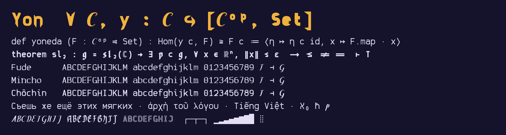

# Yon Fonts

Monospaced typefaces for [Yon](https://yon-lang.org), a topos-oriented programming language named after the Yoneda lemma.
Built for code that is mostly mathematics: every operator, arrow and math alphabet you are likely to type sits on the same 600-unit grid as the letters.



## Families

| Family | Character | Weights |
|---|---|---|
| **Yon Mono** | Monoline, the default for editors and terminals | Regular, Bold |
| **Yon Mono Fude** | Brush (筆): pressure and nib angle on the letters | Regular, Bold |
| **Yon Mono Mincho** | Mincho (明朝): thick verticals, thin horizontals, small *uroko* terminals | Regular, Bold |
| **Yon Chōchin Text** | Lantern lettering (提灯) as seen outside izakaya: slanted cut strokes; tuned for code sizes | Regular, Bold |
| **Yon Chōchin Display** | Same design with deeper cuts, for headings and signage | Regular, Bold |

Math symbols, arrows, box drawing, Braille and the mathematical alphabets (𝒞, 𝔤, ℝ) are identical across families, so a proof reads the same whichever style you pick.

## Coverage

3276 characters per font, including:

- **Latin**: Basic, Latin-1, Extended-A/B, Extended Additional (Vietnamese with stacked marks), digraphs Dž Lj Nj
- **Greek**: monotonic and polytonic (ἀρχὴ, ᾠδή)
- **Cyrillic**: Russian, Ukrainian, Belarusian, Serbian, Macedonian, Bulgarian, plus Kazakh/Tajik letters
- **Math**: arrows (2190–21FF, 27F0–27FF, Supplemental Arrows-B with ⥤ ⤳ ⤖), mathematical operators (2200–22FF), supplemental operators, misc. math A/B, ⟨ ⟩ ⟪ ⟫ ⟦ ⟧
- **Math alphabets**: bold 𝐒𝐞𝐭, italic 𝑥, bold italic, sans-serif, monospace (Latin, Greek and digits), double-struck 𝔸–𝕫 𝟘–𝟡, script 𝒜–𝓏 and bold script 𝓐–𝔃, Fraktur 𝔄–𝔷 and bold Fraktur 𝕬–𝖟, letterlike ℂ ℍ ℕ ℙ ℚ ℝ ℤ ℬ ℰ ℱ ℋ ℐ ℒ ℳ ℛ ℭ ℌ ℑ ℜ ℨ ℘ ℏ ℵ
- **Super/subscripts**: digits and letters (xᵢ, ℝⁿ, 𝒞ᵒᵖ)
- **Terminal**: full box drawing, block elements, Braille patterns, geometric shapes, Powerline
- **Ligatures** (`calt`): `->` `<-` `=>` `<=>` `<=` `>=` `!=` `==` `:=` `|->`

## Install

Download the latest release, or take the files directly from `fonts/`:

- `fonts/ttf/` — desktop and editors (TrueType, hinted with ttfautohint)
- `fonts/webfonts/` — WOFF2 for the web

VS Code:

```json
"editor.fontFamily": "'Yon Mono', monospace",
"editor.fontLigatures": true
```

CSS:

```css
@font-face {
  font-family: "Yon Mono";
  src: url("YonMono-Regular.woff2") format("woff2");
  font-weight: 400;
}
```

CDN:

```css
@font-face {
  font-family: "Yon Mono";
  src: url("https://cdn.jsdelivr.net/gh/yon-language/yon-fonts@v2.1/fonts/webfonts/YonMono-Regular.woff2") format("woff2");
  font-weight: 400;
}
```

Replace `YonMono-Regular` with the name of any file in `fonts/webfonts/` to load another family or weight.

## License

The fonts are released under the [SIL Open Font License 1.1](OFL.txt): free to use, embed, modify and redistribute, including in commercial work; they cannot be sold on their own.

Designed by Antonio Mennillo.
